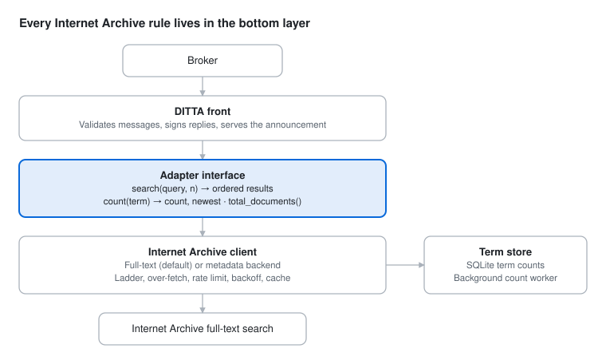

# DITTA Internet Archive Adapter — Design

Oct 28, 2026

## Purpose and scope

The adapter is a free DITTA indexer whose corpus is the Internet Archive's item catalogue. It takes a DITTA query string, translates it into an Internet Archive search, and returns DITTA results: identifier, URL, title, snippet.

It is thin by design. It holds no copy of the corpus, only a response cache and a table of term counts. Everything the Internet Archive asks of automated clients is enforced in one place, so the adapter can run politely from outside the Archive today and serve as a working model for an indexer the Archive runs itself.

## Architecture

The adapter has three layers, and only the bottom one knows anything about the Internet Archive.

The front is the same for every DITTA indexer. Another source, such as a Wayback adapter, implements the same three calls in the middle layer and reuses the front unchanged.

## Query interpretation

The query string is treated as a bag of terms: all terms must match, and if that returns nothing, any term may match. The protocol leaves interpretation to the indexer, so this translation is the adapter's main job.

1. Split the string on whitespace.
2. Escape every Lucene special character in each term, so the caller can never inject field queries, wildcards or ranges.
3. Join the terms with AND and run the search.
4. If that returns fewer results than requested, search for items matching every term but one (an OR of the AND of each subset missing one term; 3 to 8 terms only), then, if still short, any term (OR). Each step's new results go after the earlier ones, so stricter matches always rank first.
5. An empty query returns an error rather than a search.

Every search is also limited to the announced languages, `en` by default and configurable. Items labelled English and items with no language label are kept; only items labelled in another language are left out. About a third of Archive items carry no label, so requiring one would drop much good audio and video. Counts and the corpus size use the same filter.

The raw string is never passed through. The spec treats it as attacker-controlled input at the indexer, and here a pass-through would also let callers send expensive queries to the Archive's servers under the adapter's name.

## Result mapping

Each query is one search request that asks only for the fields below, so no per-result metadata lookups are ever made.

| DITTA field | Internet Archive source | Shaping |
| --- | --- | --- |
| Document identifier | `identifier` | As is; stable and unique within the Archive |
| URL | `https://archive.org/details/{identifier}` | Built, never taken from metadata |
| Title | `title` | First value if an array; identifier if missing |
| Snippet | `description` | First value if an array, HTML tags stripped, whitespace collapsed, cut to 300 characters; without one, a line from creator, year, media type and subjects |

Results keep the Archive's order, best first, since a DITTA result set carries no score. The search must use the paged form with `page` and `rows`: the library's default returns every match sorted by identifier, which breaks the best-first rule. A live run on 2026-10-29 confirmed that the paged form returns relevance order, not identifier order.

The result count never exceeds the query's max result count. Only texts are searched by default (books, scanned pages and documents; configurable), which keeps video and podcasts out; an item is returned when it has an identifier and some text for a snippet.

## Internet Archive access rules

Every request goes through the official `internetarchive` Python library, which is the Archive's supported path to search and handles the User-Agent suffix and credentials. The Archive's [automated access guidance](https://archive.org/developers/bots.html) sets the rules below.

- **User-Agent:** a tool name and version on every request, such as `ditta-ia-adapter/0.2.0 (+https://example.com)`. The URL is the operator's contact page, set in configuration, so the Archive can see who runs it and how to reach them. No model name, since the adapter is not an AI agent.
- **Rate limits:** honour `429` responses and `Retry-After`, with exponential backoff on errors.
- **Caching:** identical searches within a short window are served from cache instead of re-sent.
- **Concurrency:** a small fixed cap on simultaneous requests (2), and a minimum gap between request starts (1 second).
- **Credentials:** authenticate when an account key is available, read from the library's own `IA_ACCESS_KEY_ID` and `IA_SECRET_ACCESS_KEY`.
- **AI agents:** the adapter is not one and names no model; any request an AI coding agent makes during development names its model in the User-Agent, as the Archive's rules require.

While the client is backing off, the adapter returns an error to new queries instead of searching. It never answers a query with an empty result set because it was throttled, since a broker would read that as no matches.

## Corpus statistics

Term counts are built lazily from real demand, so the reported terms reflect what people search rather than the Archive's metadata boilerplate. A term's statistics come from one search for that term with one row, newest first: `numFound` is its document count and the top item's date is its freshness marker (`newest` in statistics format 0).

- **Seeding:** the term table starts from the operator's own targeted searches, which breaks the cold start where no stats means no routed queries.
- **Backfill:** each served query adds its terms, minus stopwords, to a queue. A background worker counts queued terms one at a time with a few seconds between requests.
- **Staleness:** each term stores `count`, `newest`, `counted_at` and `last_requested`. The oldest counts are refreshed first, and terms not requested for a long period age out.
- **Snapshot time:** the corpus-updated timestamp is the time of the last completed refresh pass.

The queue stores bare terms only. It never records whole query strings, requester pubkeys or per-query timestamps, so it cannot reconstruct who searched for what. Per-broker data, if ever needed for rate limiting, lives in a separate short-lived store that is never joined to the term table.

## Announcement and pricing

The adapter is free: it announces a single `per_query` pricing option at a price of 0 and never sends a 402 challenge. Free access avoids charging for the Archive's data and keeps the adapter a clean demonstration.

The announcement names the indexer role with a corpus description pointing to the Internet Archive, and serves corpus statistics from the term table. Its total document count is the size the Archive publishes through its search API (`numFound` for `*:*` under the media-type and language filters: 42,932,422 English or unlabelled texts of 128,351,232 items on 2026-10-29), refreshed daily. Every message the adapter sends is signed, result sets and errors included.

For discovery, the adapter keeps the newest valid announcement per pubkey, relays each new one unchanged to the other nodes it knows, and announces itself to every node it has seen, starting from a seed list in configuration. It never connects to loopback, private or link-local addresses unless configured to, and bounds its outbound connection rate.

## Repository and README

The adapter lives in a public repo on the maintainer's GitHub account, not under the ditta-protocol organisation, because it is a third-party implementation rather than an official part of DITTA. It starts empty, so an MIT LICENSE file and a Python .gitignore go in with the first commit; the .gitignore also excludes the SQLite term store and the response cache.

The README is the adapter's front page for two readers: the Internet Archive, checking what is hitting its servers, and developers who want to run it or build a similar adapter. It has to be thorough and plain, and cover:

- **What DITTA is:** a short explanation of the protocol, linking to the DITTA spec. The architecture diagram goes in near the top, as an SVG file in the repo.
- **What this adapter does:** queries in, Internet Archive results out, free, and unofficial.
- **How queries are read:** term escaping, AND with one OR fallback, and why the raw string is never passed through.
- **How it treats the Archive:** the User-Agent, rate limits, backoff, caching and the concurrency cap, with a link to the Archive's automated access guidance.
- **Corpus statistics:** how term counts are built from served queries, and what the term store never records.
- **Running it:** requirements, configuration, credentials and how to start it.
- **Limits:** what v1 leaves out, such as the Wayback Machine.

## Out of scope for v1, and open items

Three Internet Archive services are deliberately left out of v1:

- **Changes API:** not needed for freshness, since the corpus timestamp comes from the stats refresh.
- **Views API:** possible ranking input later; the Archive's relevance order is used as is.
- **Wayback Machine:** a different corpus with no full-text search, better served by a separate adapter.

Open items:

- [x] Whether to filter by `mediatype`. Decided: texts only by default, configurable. First decided as no filter; changed on 2026-10-29 because video and podcasts crowded the results.
- [x] Snippet length limit. Decided: 300 characters.
- [x] Whether result sets are signed. Decided: every message is signed.
- [x] Cache window and the cap on concurrent requests. Decided: 10 minutes and 2 requests.
- [x] Confirm that the paged search returns results in relevance order. Confirmed 2026-10-29.
- [x] Choose the license: MIT.
